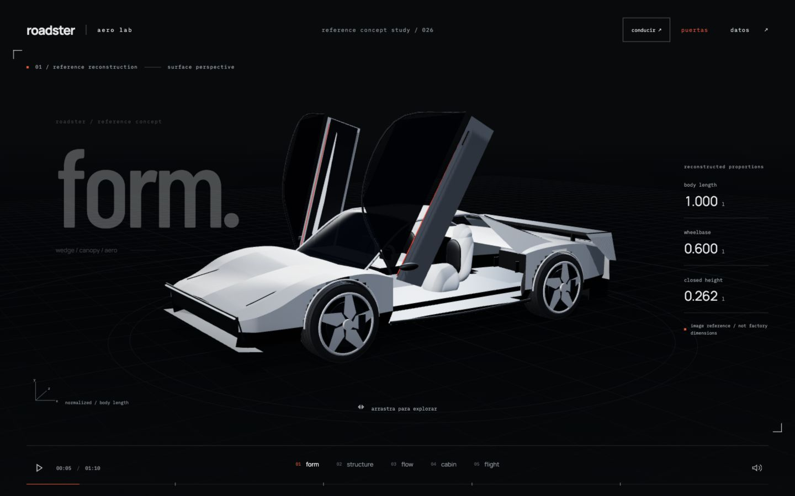
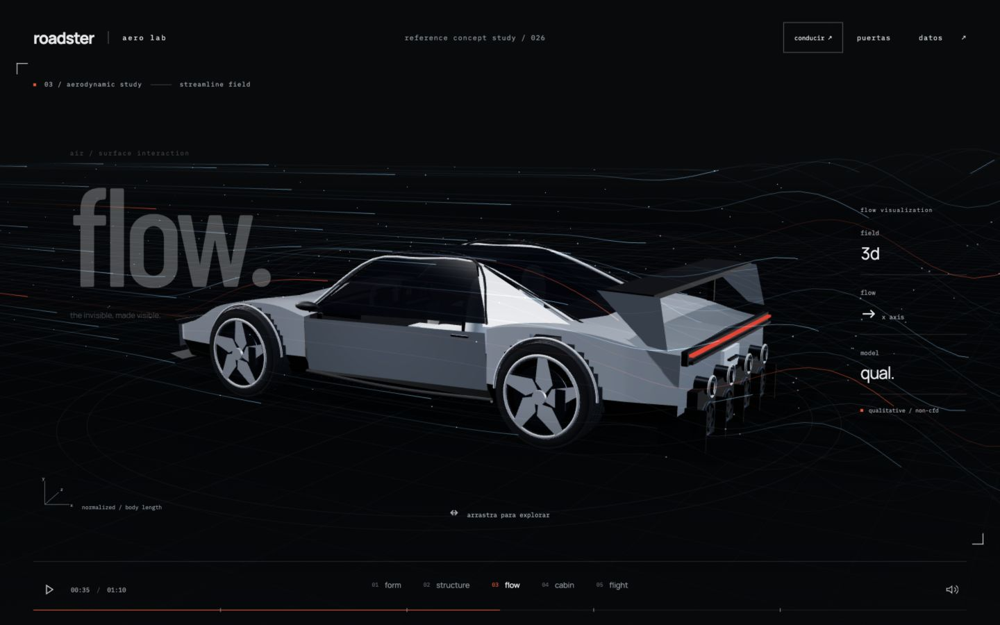
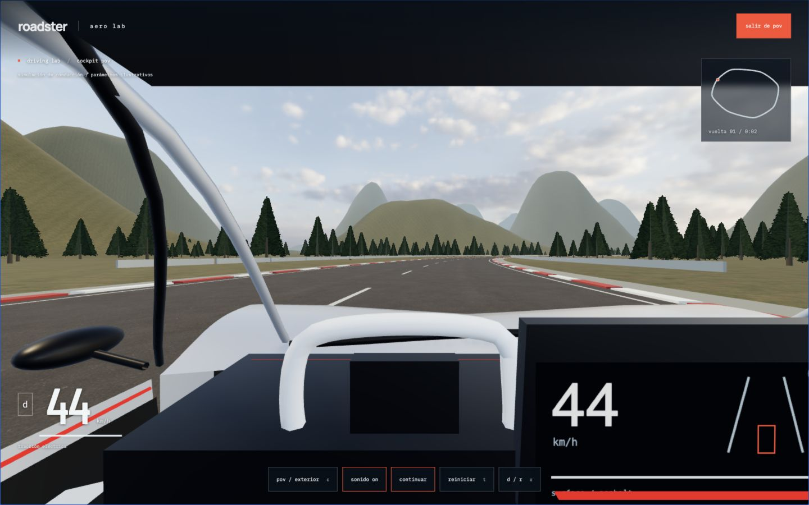
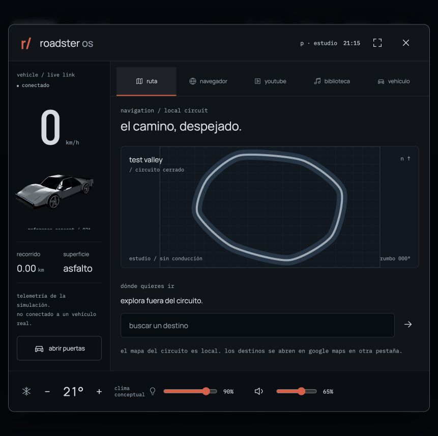
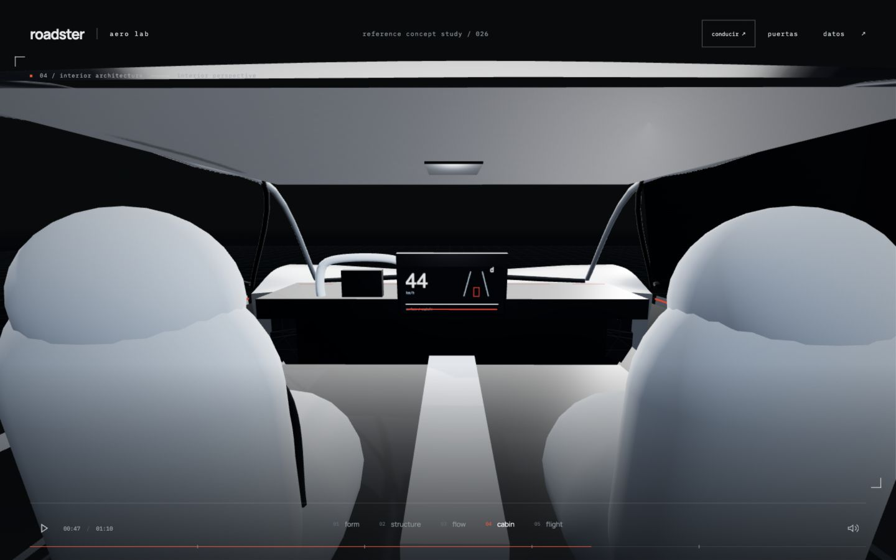

# roadster aero lab

reconstrucción tridimensional de un concepto roadster a partir de imágenes y vídeo de referencia. incluye una secuencia de 70 segundos y un circuito conducible con cámara pov, física aproximada y audio reactivo.

[ver sitio](https://kisnner26.github.io/roadster-aero-lab/)



## incluye

- carrocería blanca facetada, cabina cerrada y luces de ancho completo
- puertas animadas, cinco radios por rueda, alerón y cuatro boquillas traseras
- cinco capítulos: superficie, estructura, flujo, habitáculo y vuelo conceptual
- iluminación de estudio, sombras, malla técnica y proporciones proyectadas en 3d
- líneas de corriente y partículas animadas mediante shaders
- yoke, pantalla central, asientos claros y revestimiento interior
- cúpula de cristal curvada, cintura más estrecha y alerón retráctil
- conducción con aceleración, frenado regenerativo, reversa, agarre limitado y menor tracción sobre grava
- pov desde el asiento del conductor y cámara exterior; tablero, mapa y contador de vueltas
- motor eléctrico sintetizado, viento, rodadura y derrape ligados al estado del coche
- circuito con texturas locales, cielo hdr, guardarraíles y controles táctiles
- roadster os: pantalla interactiva con navegación, youtube, archivos locales y ajustes de cabina
- tierra procedural, estrellas y una escena especulativa de propulsión
- cámaras continuas, exploración táctil, navegación y línea de tiempo
- sonido ambiental opcional, movimiento reducido y pausa al ocultar la pestaña
- tipografías locales; ningún recurso remoto necesario durante la reproducción





## controles

arrastra para orbitar. selecciona un capítulo o arrastra la línea de tiempo para buscar un instante. el botón `puertas` abre o cierra ambos paneles. espacio pausa o reproduce; las flechas y la rueda cambian de capítulo. el sonido comienza únicamente al activarlo.

pulsa `conducir` para entrar al circuito y activar el audio. `w` / `↑` acelera, `s` / `↓` frena y `a` / `d` gira. espacio acciona el freno de mano; `c` cambia de cámara, `r` selecciona reversa al detenerte, `p` pausa, `t` reinicia y escape vuelve al estudio. en móvil hay dirección y pedales para mantener pulsados. arrastra la vista para mirar a los lados desde el asiento. la conducción se pausa al perder el foco o esconder la pestaña.

pulsa `pantalla`, `e` o toca la pantalla 3d desde el habitáculo para abrir roadster os. escape cierra la interfaz y devuelve el foco. la conducción queda pausada hasta continuar; las puertas deben estar cerradas. el mapa, el historial de velocidad y la telemetría usan el estado de la simulación. la miniatura renderiza la misma geometría del coche.



### pantalla y conectividad

- youtube: pega un enlace normal, corto o de shorts. usa el reproductor oficial sin autoplay; los vídeos restringidos ofrecen salida a youtube.
- navegador: búsquedas reales en google y direcciones externas en otra pestaña; vista interna aislada para webs que permiten iframes. no emula chrome ni elude restricciones de los sitios.
- biblioteca: audio y vídeo desde el dispositivo mediante urls de objeto; no se suben archivos. cambiar de aplicación o cerrar la pantalla pausa la reproducción.
- ajustes: volumen del coche y archivos locales, brillo de la interfaz y luz real de la escena. la temperatura es conceptual, no una simulación térmica.
- privacidad: youtube solo se conecta al cargar un vídeo. la vista web solo carga la dirección solicitada. únicamente las preferencias de cabina se guardan en localstorage; no se guardan búsquedas ni archivos.

[vista móvil](public/assets/roadster-os-mobile.jpg) · [youtube reproduciendo](public/assets/roadster-os-youtube.jpg) · [arquitectura y límites](docs/infotainment.md)



## desarrollo

```bash
npm install
npm run dev
```

validación:

```bash
npm run check
npm test
npm run build
```

## fuentes

- cinco imágenes de referencia aportadas por el usuario: frontal con puertas abiertas, tres cuartos trasero, trasera, interior y vista superior
- [vídeo de referencia proporcionado](https://www.youtube.com/shorts/oCvC70oIS5w)
- [tesla roadster oficial](https://www.tesla.com/roadster)

three.js, gsap, web audio y vite. el estudio se evalúa desde un tiempo absoluto. la conducción usa un modelo de bicicleta con pasos fijos de 1/120 s, resistencia aerodinámica, regeneración y límites de agarre. los sonidos se sintetizan en el navegador; no son grabaciones del vehículo real.

el cielo y las texturas de [poly haven](https://polyhaven.com/) son cc0; fuentes y licencias en [créditos del entorno](public/assets/driving/CREDITS.md). todos los recursos se sirven desde este repositorio.

proyecto independiente no afiliado a tesla ni spacex. no se ha confirmado que el diseño de las referencias sea oficial. la geometría es una interpretación visual, no un cad de fabricación.

las proporciones se normalizan a la longitud de la carrocería (`l`): longitud `1.000 l`, batalla `0.600 l`, ancho `0.440 l` y altura con puertas cerradas `0.262 l`. son estimaciones del modelo, no dimensiones físicas certificadas. no se reutilizan las cotas del roadster de primera generación para esta carrocería. el flujo es cualitativo, no cfd; la propulsión y la escena espacial son especulativas, no una recreación de la misión de 2018.

la conducción busca una respuesta creíble, pero sus parámetros, prestaciones y circuito son ilustrativos y no están validados por tesla. el agua, los árboles y los guardarraíles usan colisiones simplificadas; no se simulan daños ni suspensión independiente por rueda.

las fuentes barlow condensed, ibm plex mono y manrope se distribuyen con sus licencias sil open font license en `public/fonts`.
