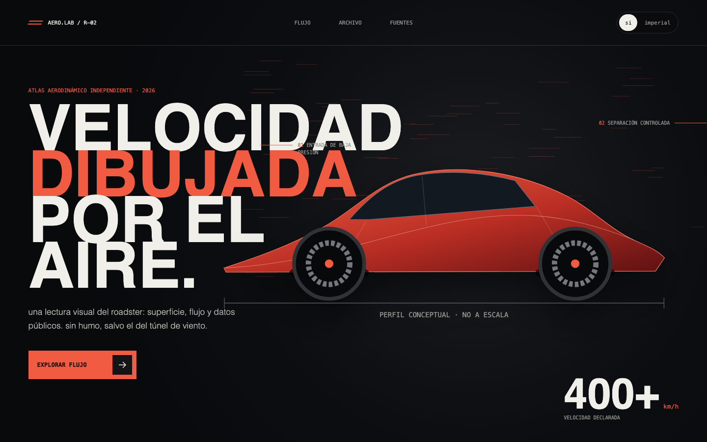

# roadster aero lab

atlas web independiente sobre la aerodinámica del tesla roadster, sus prestaciones declaradas y las cotas públicas del roadster 2.5 original.

[ver sitio](https://kisnner26.github.io/roadster-aero-lab/)



## incluye

- visualización animada y controlable del flujo de aire
- conversión entre unidades si e imperiales
- plano vectorial basado en las cotas oficiales del manual roadster 2.5
- separación explícita entre datos del modelo original y cifras declaradas del nuevo roadster
- diseño responsive, navegación por teclado y reducción de movimiento

## desarrollo

```bash
npm install
npm run dev
```

validación:

```bash
npm run check
npm run build
```

## fuentes

- [tesla roadster](https://www.tesla.com/es_es/roadster)
- [manual del propietario roadster 2.5](https://service.tesla.com/docs/Public/Roadster/Owner/Roadster_2.5_Owners_Manual.pdf)
- [manual de servicio roadster](https://service.tesla.com/docs/Public/Roadster/ServiceManual/en-us/GUID-4E037ADB-D0F4-48A0-9261-1083193D4C1B.html)

proyecto educativo no afiliado a tesla, inc. las ilustraciones son reconstrucciones visuales, no archivos cad ni planos de fabricación.
