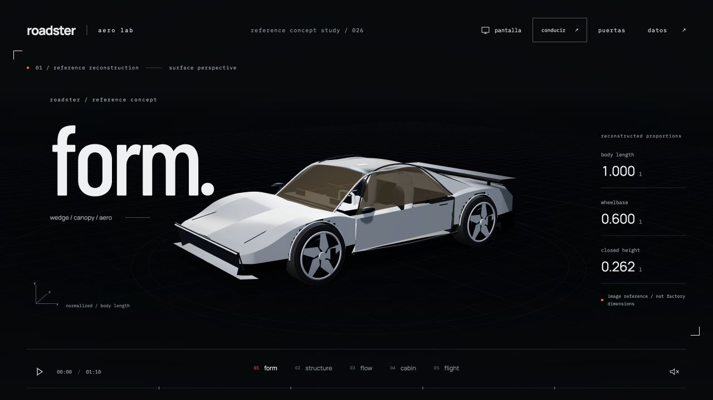
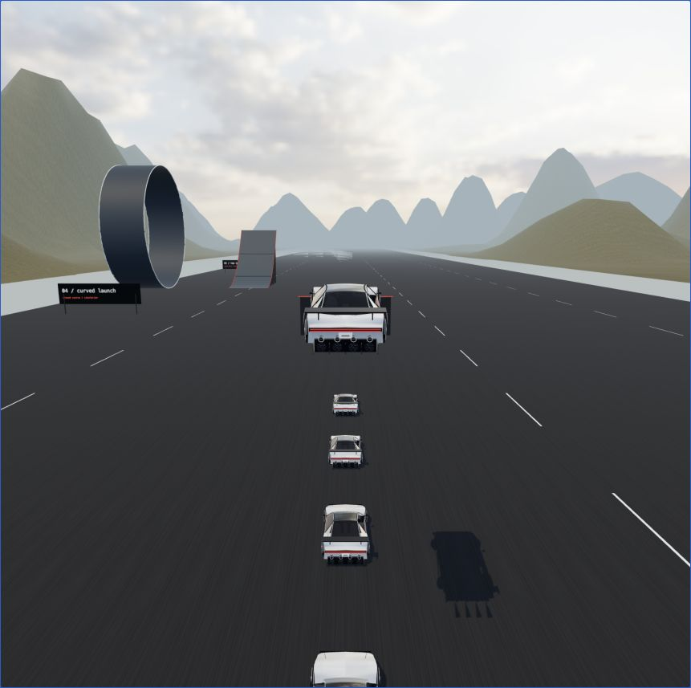
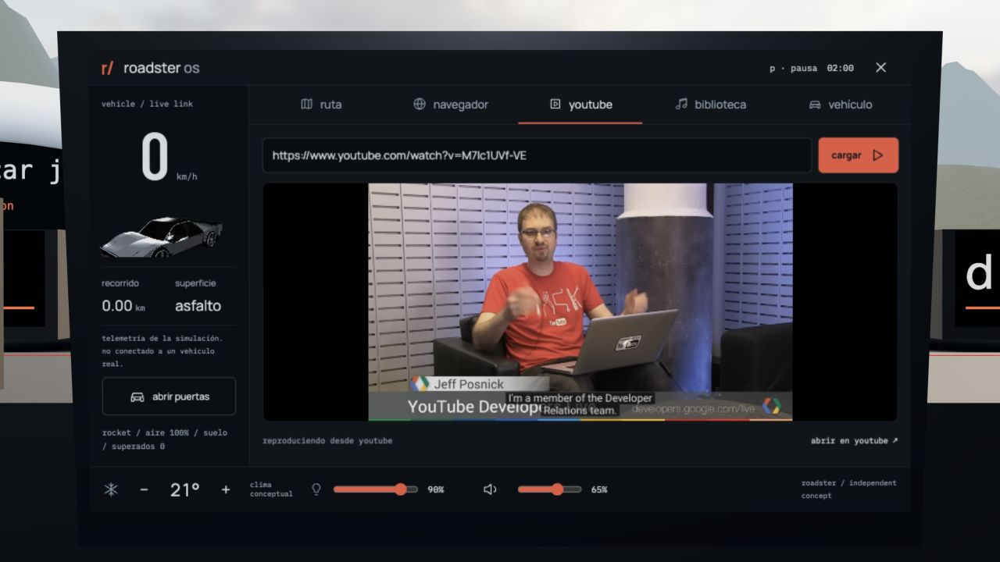
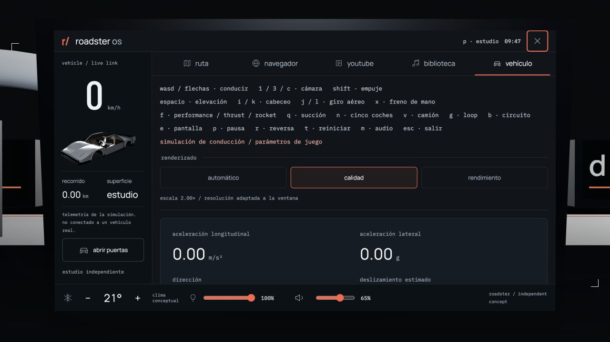

# roadster aero lab

reconstrucción independiente del nuevo roadster a partir de referencias visuales. estudio de 70 segundos y modo de juego con primera/tercera persona, propulsión, saltos y una pantalla multimedia integrada en el habitáculo.

[ver sitio](https://kisnner26.github.io/roadster-aero-lab/)



## incluye

- carrocería blanca facetada, cabina cerrada y luces de ancho completo
- puertas animadas, cinco radios por rueda, alerón y cuatro boquillas traseras
- cinco capítulos: superficie, estructura, flujo, habitáculo y vuelo conceptual
- iluminación de estudio, sombras, malla técnica y proporciones proyectadas en 3d
- líneas de corriente y partículas animadas mediante shaders
- yoke, pantalla central, asientos claros y revestimiento interior
- cúpula de cristal curvada, cintura más estrecha y alerón retráctil
- conducción con aceleración, frenado regenerativo, reversa, agarre limitado y menor tracción sobre grava
- primera y tercera persona sin hud flotante; información en las pantallas físicas del coche
- cámara exterior con distancia estable a alta velocidad, luces de frenado/regeneración, reversa y aerofreno ligados a la conducción
- performance, thrust y rocket; aire limitado, elevación, giro aéreo, succión y aerodinámica activa aproximadas
- cinco coches para saltar, un camión, rampas, un loop de exhibición y una recta de velocidad
- motor eléctrico sintetizado, viento, rodadura y derrape ligados al estado del coche
- circuito con texturas locales, cielo hdr y guardarraíles; teclado o mando para conducir
- roadster os: html e iframes proyectados sobre el monitor 3d, no una ventana flotante
- tierra procedural, estrellas y una escena especulativa de propulsión
- cámaras continuas, exploración táctil, navegación y línea de tiempo
- sonido ambiental opcional, movimiento reducido y pausa al ocultar la pestaña
- escena y tipografías locales; youtube y páginas externas requieren conexión
- resolución adaptativa y perfiles automático, calidad y rendimiento dentro del monitor; circuito cargado bajo demanda




## controles

arrastra para orbitar. selecciona un capítulo o arrastra la línea de tiempo para buscar un instante. el botón `puertas` abre o cierra ambos paneles. espacio pausa o reproduce; las flechas y la rueda cambian de capítulo. el sonido comienza únicamente al activarlo.

pulsa `conducir`. `wasd` / flechas: conducir; `1` / `3`: primera/tercera persona; `c`: alternar; `shift`: empuje; espacio: elevación rocket; `i` / `k`: cabeceo; `j` / `l`: giro aéreo; `x`: freno de mano; `f`: configuración; `q`: succión.

`n`: cinco coches; `v`: camión; `g`: loop; `b`: circuito; `p`: pausa; `t`: reiniciar zona; `r`: reversa al detenerte; `m`: audio; escape: estudio. arrastra para mirar u orbitar. un mando estándar admite stick izquierdo, gatillos para pedales y botones 0/1 para empuje/elevación.

`e` o tocar el monitor: acercar la cámara a la pantalla física; `h`: controles dentro del coche. escape devuelve la cámara. la conducción queda pausada hasta pulsar `p`; las puertas deben estar cerradas. la pantalla es html operativo proyectado con la cámara de la escena, incluyendo los iframes de youtube. los vídeos siguen en ese monitor al devolver la vista al habitáculo. el modo de juego está pensado para teclado o mando; no hay botones táctiles flotantes.



### pantalla y conectividad

- youtube: pega un enlace normal, corto o de shorts. usa el reproductor oficial sin autoplay; los vídeos restringidos ofrecen salida a youtube.
- navegador: búsquedas reales en google y direcciones externas en otra pestaña; vista interna aislada para webs que permiten iframes. no emula chrome ni elude restricciones de los sitios.
- biblioteca: audio y vídeo desde el dispositivo mediante urls de objeto; no se suben archivos. cambiar de aplicación pausa el contenido anterior; salir de la vista ampliada no apaga el monitor.
- ajustes: volumen del coche y archivos locales, brillo de la interfaz, luz real de la escena y perfil gráfico desde `h` → vehículo. la temperatura es conceptual, no una simulación térmica.
- privacidad: youtube solo se conecta al cargar un vídeo. la vista web solo carga la dirección solicitada. se guardan únicamente preferencias de cabina y perfil gráfico en localstorage; no se guardan búsquedas ni archivos.

[arquitectura de la pantalla](docs/infotainment.md) · [fuentes y límites de conducción](docs/driving-model.md) · [loop en funcionamiento](public/assets/roadster-stunt-loop.jpg) · [vídeo desde el asiento](public/assets/roadster-pov-media.jpg)



[presupuestos y mediciones de rendimiento](docs/performance.md): texturas 71 % más ligeras, tipografías 59 % más ligeras y una muestra de la pista de saltos con 581 llamadas de dibujo frente a 1,084. son mediciones locales, no garantías de fps.


## desarrollo

```bash
npm install
npm run dev
```

validación:

```bash
npm run check
npm test
npm run build
npm run check:build
npm run benchmark:track
```

## fuentes

- cinco imágenes de referencia aportadas por el usuario: frontal con puertas abiertas, tres cuartos trasero, trasera, interior y vista superior
- [vídeo de referencia proporcionado](https://www.youtube.com/shorts/oCvC70oIS5w)
- [tesla roadster oficial](https://www.tesla.com/roadster)

three.js, gsap, web audio y vite. el estudio se evalúa desde un tiempo absoluto. la conducción usa un modelo de bicicleta con pasos fijos de 1/120 s, resistencia aerodinámica, regeneración y límites de agarre. los sonidos se sintetizan en el navegador; no son grabaciones del vehículo real.

el cielo y las texturas de [poly haven](https://polyhaven.com/) son cc0; fuentes y licencias en [créditos del entorno](public/assets/driving/CREDITS.md). todos los recursos se sirven desde este repositorio.

proyecto independiente no afiliado a tesla ni spacex. el diseño se contrasta con la ficha oficial actual; la geometría sigue siendo una reconstrucción visual, no un cad del fabricante.

las proporciones se normalizan a la longitud de la carrocería (`l`): longitud `1.000 l`, batalla `0.600 l`, ancho `0.440 l` y altura con puertas cerradas `0.262 l`. son estimaciones del modelo, no dimensiones físicas certificadas. no se reutilizan las cotas del roadster de primera generación para esta carrocería. el flujo es cualitativo, no cfd; la propulsión y la escena espacial son especulativas, no una recreación de la misión de 2018.

la conducción y los saltos usan parámetros de juego, no prestaciones verificadas de un coche de producción. el límite de 403.2 km/h, la capacidad de aire y su recarga son decisiones de simulación. el loop utiliza contacto geométrico restringido; no reproduce el sistema de succión real. no hay daños, neumáticos deformables ni suspensión independiente por rueda. detalles y fuentes en [modelo de conducción](docs/driving-model.md).

las fuentes barlow condensed, ibm plex mono y manrope se distribuyen con sus licencias sil open font license en `public/fonts`.
